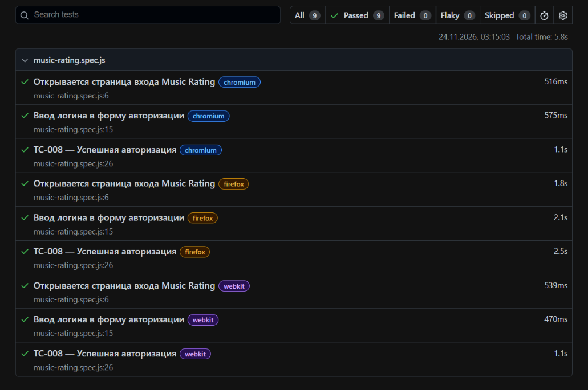

# Music Rating — QA Portfolio

Практический проект по тестированию веб-приложения Music Rating.

## О проекте

Цель проекта — развитие практических навыков ручного
и автоматизированного тестирования веб-приложений.

## Технологии и инструменты

- Playwright
- JavaScript
- Node.js
- Git / GitHub
- dotenv
- XAMPP

## Автоматизированные сценарии

- Проверка открытия страницы авторизации.
- Проверка ввода имени пользователя.
- Проверка успешной авторизации.

## Кросс-браузерное тестирование

- Chromium
- Firefox
- WebKit

## Результаты тестирования

- Тестовых сценариев: 3
- Всего запусков: 9
- Успешных запусков: 9
- Неуспешных запусков: 0

## Запуск проекта

Для запуска необходимо:

1. Установить Node.js.
2. Запустить Apache и MySQL через XAMPP.
3. Развернуть приложение Music Rating и его базу данных.
4. Убедиться, что приложение доступно по адресу:
   http://localhost/MUSIC_site_portfolio/
5. Создать тестовую учётную запись.
6. Установить зависимости:

```bash
npm ci
npx playwright install
```

7. Создать файл .env на основе .env.example
   и указать данные тестовой учётной записи.

8. Запустить автотесты:

```bash
npx playwright test
```

## Просмотр HTML-отчёта

```bash
npx playwright show-report
```

## Статус проекта

Проект находится в активном развитии.
Планируется расширение тестового покрытия,
добавление тестовой документации и API-тестов.

## Результаты автоматизированного тестирования

Выполнено 9 запусков автотестов в Chromium, Firefox и WebKit.
Все проверки успешно пройдены.

